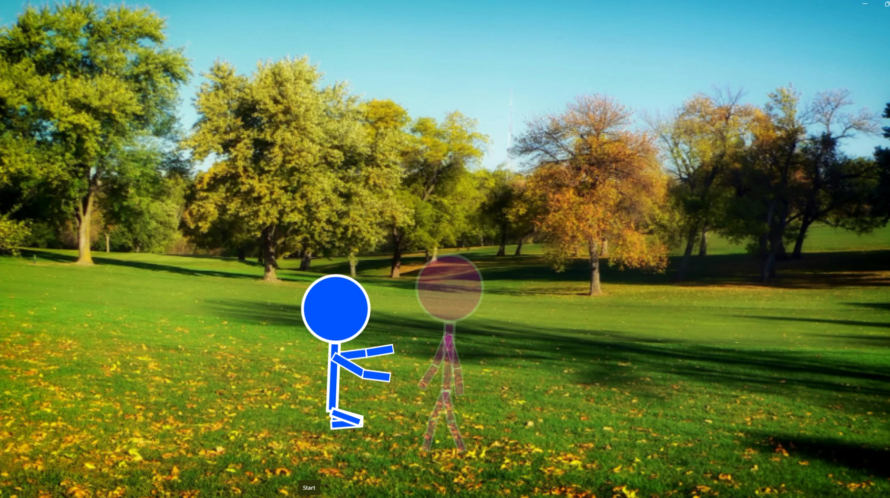

# 🎨2D Animation

## Must Forget

*Click the image below to watch the full animation on YouTube.*

Sometimes you need to forget and let go
### ✨About the Project

The story follows a blue stickman who walks through a park and encounters the mysterious ghost of a girl who suddenly vanishes. I created this project as a typography workshop. I developed the concept and animation myself in Adobe After Effects.

### 📑My Responsibilities
- Creating and animating the characters
- Creating the scene and background
- Planning the character's movements
- Creating the ghost appearance and disappearance effect

## 📝Script

### Frame 1
  &emsp; &#8209; A blue stickman walks around the desk, the inscription "Sometimes you" appears on his head.

### Frame 2

  &emsp; &#8209; The words "need to" appear at the bottom of the screen; 

### Frame 3

  &emsp; &#8209; a blue stickman stops moving, a pink stickman steps out in front of him, and the word "forget" appears above the pink stickman's head.

### Frame 4

  &emsp; &#8209; A blue stickman falls to his knees and reaches out his hands toward a pink one.

### Frame 5

  &emsp; &#8209; As it approached, the pink stickman disappeared.

### Frame 6

  &emsp; &#8209; The blue stickman curled up and punched the grass.

### Frame 7

  &emsp; &#8209; The inscription "and let go" appeared, and it moved to the right after a few seconds.
