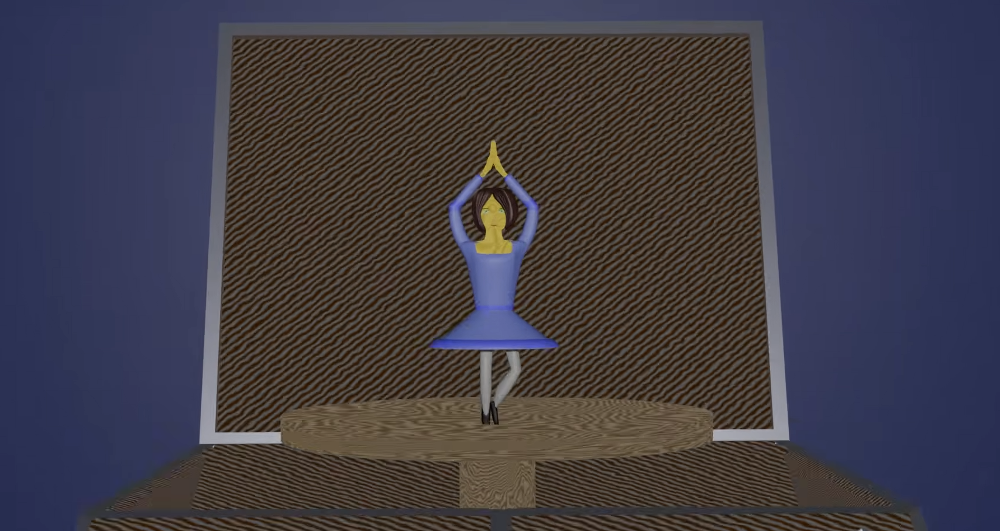
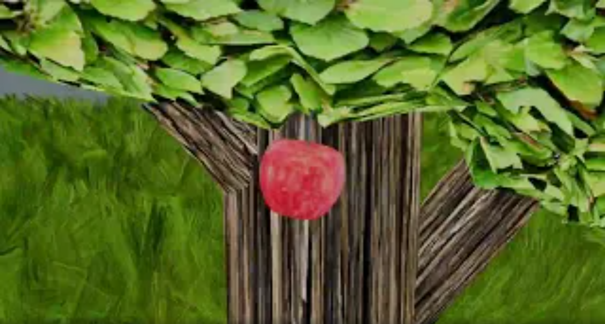

# 🎞️3D Animation

## Lost aristocrate

*Click the image below to watch animation on YouTube.*

### ✨About the Project

This is an animation about an aristocrat who somehow finds himself in the middle of a desert and tries to get home. The animation has a sequel in the form of a game where he ends up in a labyrinth. I created this animation using Blender.

### 📑My Responsibilities
- Creating and animating the main character
- Developing the scene and world
- Planning the character's movements
- Create camera movment

### 📝Script

### Frame 1

 &emsp; &#8209; The camera moves along the sand and approaches the character.

### Frame 2

  &emsp; &#8209; 	The character moves along the road, the camera is fixed behind and smoothly moves to the side

### Frame 3

  &emsp; &#8209; The camera pulls back slightly from in front of the character; the character raises a hand to shield their eyes from the sun and gaze into the distance.

### Frame 4

  &emsp; &#8209; The character lowers their hand and moves towards the camera.

### Frame 5

  &emsp; &#8209; The camera follows the receding character and slowly rises toward the sun.

## Music Box

*Click the image below to watch animation on YouTube.*

### ✨About the Project

This animation shows a music box from which a ballerina emerges and twirls on a platform to the music, after which she disappears back into the box and the lid slams shut.

### 📑My Responsibilities
- Creating figurine and box
- Developing the scene
- Planning the stand movements
- Create camera movment

### 📝Script

### Frame 1

 &emsp; &#8209; The camera moves from behind the box to the front.

### Frame 2

  &emsp; &#8209; The music box slowly opens, and a ballerina on a platform glides out.

### Frame 3

  &emsp; &#8209; The camera moves closer to the music box, and the ballerina begins to spin to the music.

### Frame 4

  &emsp; &#8209; The camera pulls back, the ballerina hiding into the box, and the lid closes.

## Falling Apple

*Click the image below to watch animation on YouTube.*

### ✨About the Project

In this animation, a young apple tree stands in the middle of a field, and an apple falls from it into the grass due to a strong gust of wind.

### 📑My Responsibilities
- Creating and animating the apple's movements
- Add grass movement
- Developing the scene
- Create camera movment

### 📝Script

### Frame 1

 &emsp; &#8209; The camera moves closer to the tree.

### Frame 2

  &emsp; &#8209; 	An apple falls from the tree into the grass; the camera follows the apple.

