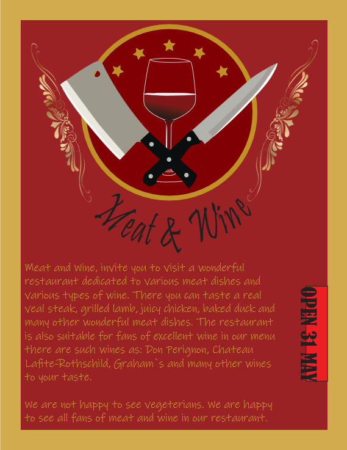
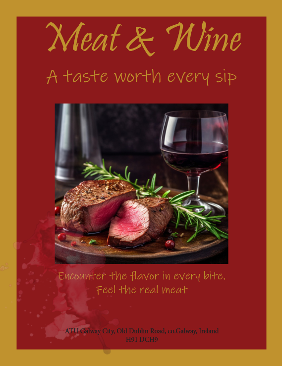
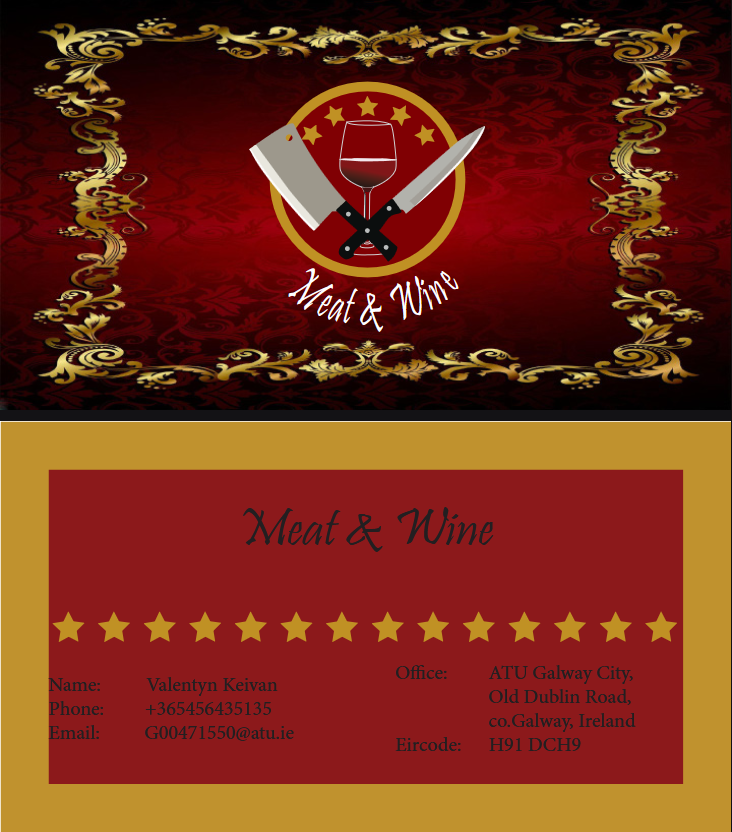
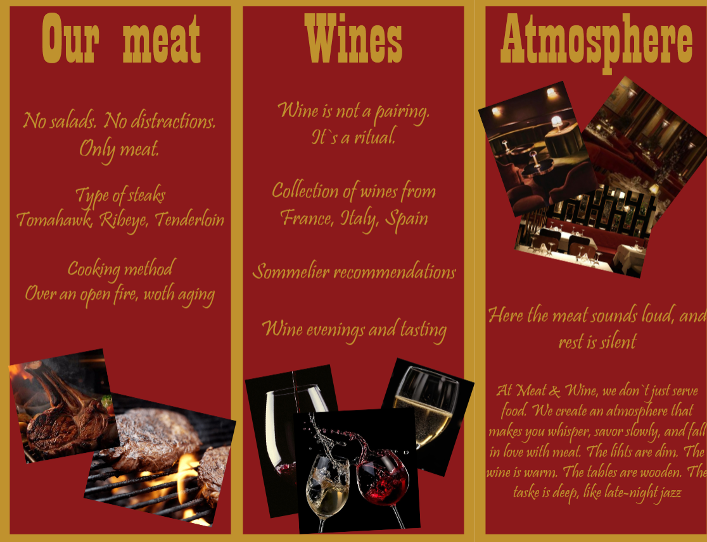
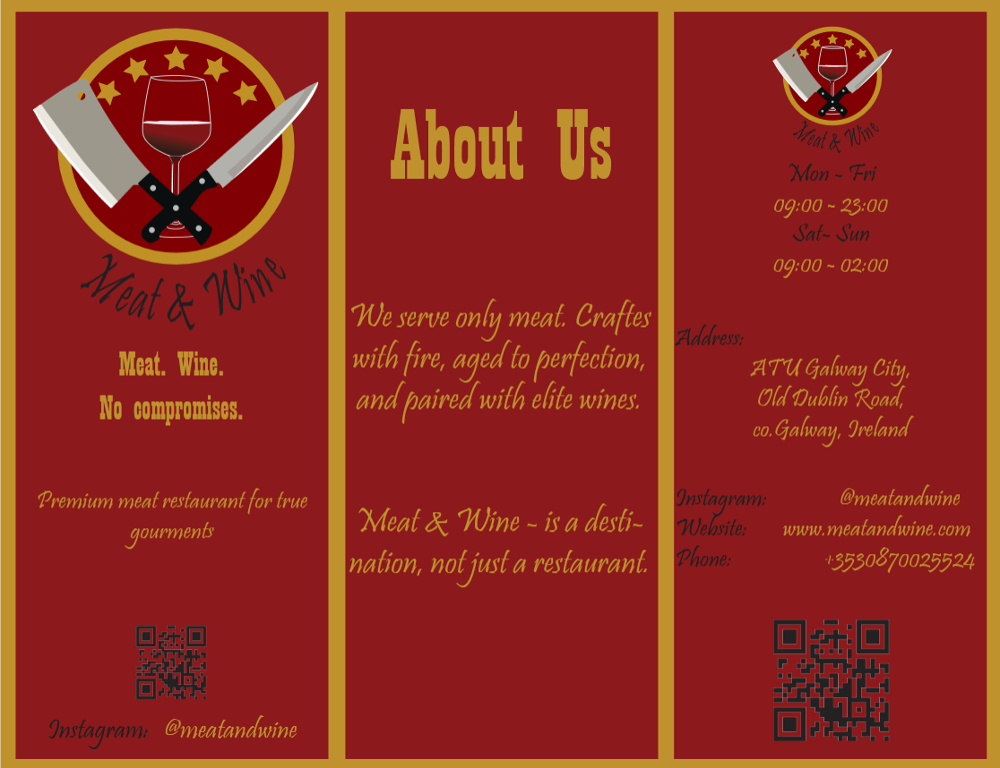

# 🖼️Graphic Design

## Meat & Wine

### ✨About the Project

A graphic design project aimed at creating professional print materials for a restaurant. It encompasses the design of a brochure, flyer, poster, and business card, created using Adobe Photoshop and Illustrator. this restaurant is
dedicated to gourmets who appreciate the taste of
meat combined with different types of wine. The
atmosphere and interior here looks very rich and the
prices are not low because all the products and wines
are very expensive. Therefore, this restaurant is aimed
mainly at people above the middle class.

### 🏞️Gallery

<table>
  <tr>
    <td width="40%">
       
    </td>
    <td width="60%" align="center" valign="medium">
      <h3>Poster</h3>
      
For the base of the poster I used basic colors, at the top I placed the logo and below it a text with a small description of my restaurant, I used two different fonts for the description and another for the message when we are opening. Next to the logo I placed two stylish pictures

    </td>
  </tr>
</table>

<table>
  <tr>
    <td width="40%">
       
<em>Click the image to view the PDF.</em>

    </td>
    <td width="60%" align="center" valign="top">
      <h3>Booklet</h3>
      
On the cover of the booklet I wrote the name of the
          restaurant, inserted a picture of our dish, also added
          the slogan and address at the bottom. I used three
          different fonts for the address, I left the basic one and
          in my opinion it looks better that way. On the last page
          there is a logo at the top, below it is the address for
          which I used a special font and golden color. Below is
          the QR code for Instagram itself, the Instagram, phone
          number and website. At the bottom I placed a text with
          a description that you can book a table with us. On the
          second page is ABOUT US there I placed the slogan
          and description about us. On the third page
          ATMOSPHERE under it the slogan and description of
          our atmosphere I also added three pictures of the
          interior. On the fourth page I placed the meat page
          under the page title another slogan. On it there are
          several pictures from the menu description to the
          page and 3 pictures from the menu of our restaurant.
          On the fifth page, I placed WINE under the slogan
          heading, followed by a page description and three
          images. The sixth page is about events that are
          happening or will happen in our restaurant and how to
          find out how to get there, namely, I left our Instagram.
          On the seventh page I posted reviews from our visitors.
          On all pages except the first and last I used red without
          a gold border and for them the basic one. For each
          section, I use different fonts, namely for the title,
          quotes, and description.
      

    </td>

  </tr>
</table>

<table>
  <tr>
    <td width="40%">
       
    </td>
    <td width="60%" align="center" valign="medium">
      <h3>Buisness Card</h3>
      
For the business card on the front side I used a picture
          that fits my style and also placed my logo and
          replaced the black font color with white for more
          contrast and easier reading. On the back side I used
          basic colors for the background and I also wrote the
          name of my restaurant at the top and separated it with
          asterisks from the main text at the bottom where the
          information is placed
      

    </td>
  </tr>
</table>

<table>
  <tr>
    <td width="40%">
       
       
    </td>
    <td width="60%" align="center" valign="medium">
      <h3>Flyer</h3>
      
On the outside of the flyer I placed the title page,
          about us and the back page. On the title page there is
          my logo, slogan and QR code for our Instagram. About
          us I wrote a little information about us. On the back
          page is the same as on the business card. In the
          middle there are also three pages, the first about our
          meat. There I placed two photos of meat dishes and
          also some information. On the middle page is wine.
          There I provided some information about the wine and
          three pictures. On the third page I wrote about the
          atmosphere and added three pictures of the interior. I
          used basic colors for all pages. Also the font is gold
          and three different fonts are used.
      

    </td>
  </tr>
</table>
