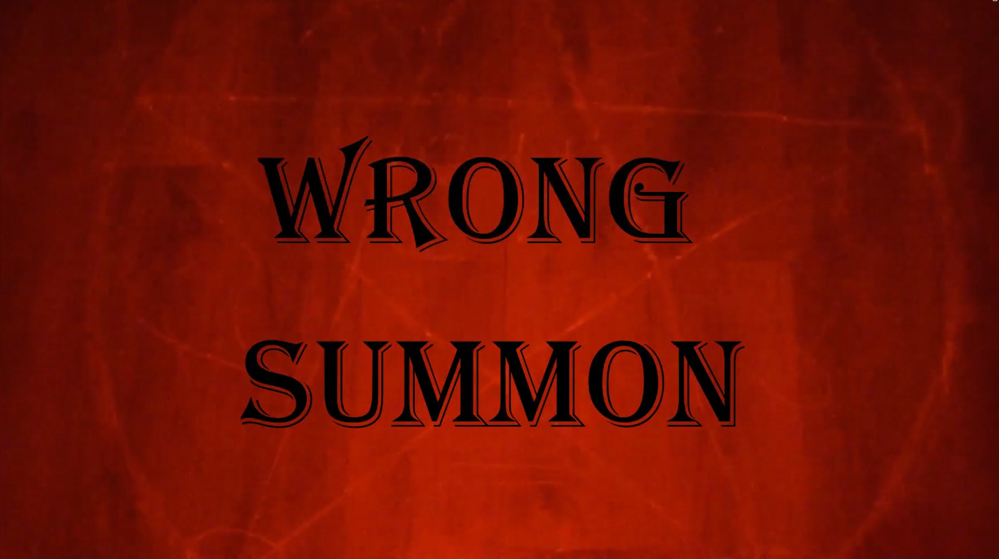

# 🎥Video Production

## Wrong Summon

*Click the image below to watch the full film on YouTube.*

A short horror film created as part of my Audio and Video Production project.

### ✨About the Project

This film is about a botched demon summoning; the protagonist decides to summon a demon but breaks the cardinal rule: never open your eyes. 
I created the story entirely myself and assembled a team to help with the filming.

### 📑My Responsibilities
- Story development and planning
- Directing the camera operator
- Acting as the main character
- Organising the filming process

## 📝Script

## Scene 1

&#8209; Location: home

&#8209; Atmosphere: horror

### Frame 1

 &emsp; &#8209; Hand draws a circle for  a ritual mystical music plays in the background and titles are show

### Frame 2

  &emsp; &#8209; Lighting candles and text with the title of the movie. Scary sounds.		

### Frame 3

  &emsp; &#8209; Placing the bowl in the centre of the circle. 

### Frame 4

  &emsp; &#8209; Take knife from the shelf

### Frame 5	

&emsp; &#8209; Lays the knife on his arm

### Frame 6

 &emsp; &#8209;  Cutting the hand and pouring “blood” into a bowl

### Frame 7
	
 &emsp; &#8209; Applying a light bandage to the arm 

### Frame 8
  
 &emsp; &#8209; Sat down in the chair assumed a relaxed posture, pressed against the back of the chair.

### Frame 9

&emsp; &#8209; Picked up the phone and read the summoning instructions.

### Frame 10
	
 &emsp; &#8209; Casting a spell

### Frame 11
	
 &emsp; &#8209; The breeze blew on the candles.

### Frame 12
	
 &emsp; &#8209; A window opening

### Frame 13

&emsp; &#8209; After the spell is read, everything calms down, and the main character opened his eyes and his face become frightened

### Frame 14 

&emsp; &#8209; He gets up and runs, turn on the light, looks around and nothing happening in the room.

### Frame 15

&emsp; &#8209; He leaves from home and runs out

## Scene 2

&#8209; Location: Front of house

&#8209; Time: night 

### Frame 1

&emsp; &#8209; Run from house

### Frame 2

&emsp; &#8209; A car is speeding and hits the character.	

### Frame 3

&emsp; &#8209; The character falls, and blood flows out from beneath him.

