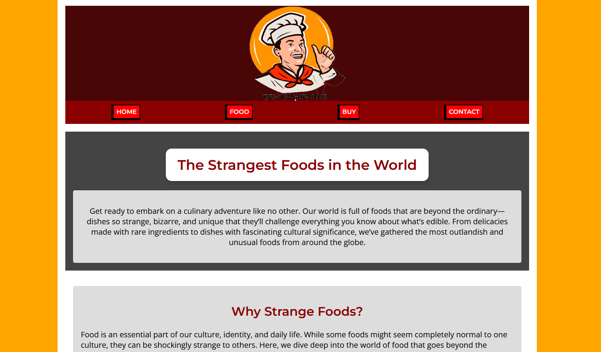
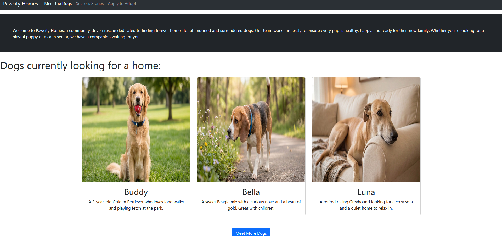

# 🌐︎Web Design

## Strange food
*Click the image below to go to website*

### ✨About the Project

That is my first website created with HTML and CSS only. On this website you can find 5 strangest dish in the world. There is 5 pages: main with information about, food with description about this food and pictures, Buy with selection food and button go to cart, cart only one page which is not on nav bar, and contact form.
### 📑My Responsibilities
- Create working HTML code with 5 pages
- Create CSS code for design website
- Find information about food and add it to website

## Pawcity Homes

  *Click the image below to go to website*

### ✨About the Project

This project was mated for bootstrap & jquery Assessment from digital design. This site contain 3 pages: Main where is 3 dogs currently looking for a home, if you press button named "meet more dogs" it will generate random pictures of dogs up to 50 images, then is carousel where you can see dogs with their stories, and apply to adopt with contact form.

### 📑My Responsibilities
- Create working bootstrap code
- Check HTML code if its work
